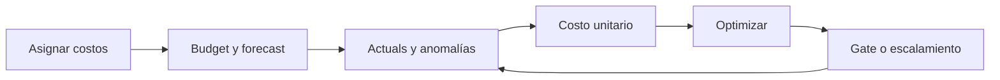
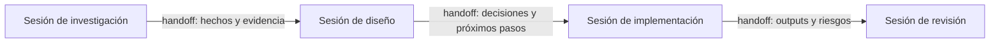
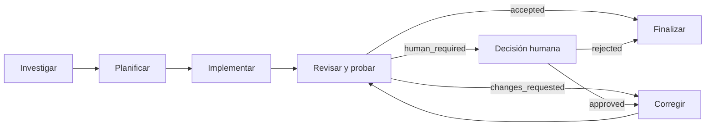

# Estándar: autoridad, roles y ejecución multiagente

> Cómo se decide, ejecuta, revisa y audita cada superficie de un proyecto sin acoplar la gobernanza a un proveedor o modelo específico.
> Versión 1.8.0 — 2026-08-04.

## Planificación proporcional al riesgo

Claude y Codex planifican antes de ejecutar, y **cuánto** planifican lo fija
[`work-proportionality.md`](work-proportionality.md): un enunciado de tres
campos en el hilo para `P2`, un plan corto para `P1`, el
work plan (precursor, `vc/docs/templates/work-plan.md` en `51fbd2a1`) completo para `P0`. La clasificación usa
impacto, incertidumbre y reversibilidad — nunca la cantidad de archivos — y el
nivel es el máximo de los tres ejes.

Cada tarea conserva `skillSource`, `skill`, `status`, `plannedBy` y evidencia
**cuando produce un artefacto de plan**, que es a partir de `P1` cruzando
sesiones. Un `P2` no genera entrada en el DAG de planificación: su evidencia es
el mensaje de commit y los gates que corrió.

**Esta sección reemplaza la política plana anterior**, que exigía plan aprobado
para toda tarea «sin excepción» y declaraba que no distinguía entre
implementación, investigación, revisión, documentación ni operaciones. Convivía
con la frase de al lado —«una tarea simple usa un micro-plan proporcional»— y
las dos no podían ser ciertas a la vez. La regla también era circular: prohibía
**leer e investigar** sin plan registrado, y no hay forma de planificar sin leer
primero. Ver [`work-proportionality.md`](work-proportionality.md).

## Vista local

La matriz de referencia dispone de una vista HTML navegable en `../../../role-matrix.html`, junto al roadmap del workspace. La vista toma sus datos de `examples/role-matrix.example.json` mediante un archivo generado compatible con apertura local.

Después de modificar la matriz de referencia, regenerar y validar la vista con:

```bash
node tools/build-role-matrix-view.mjs
```

## Objetivo

Este estándar permite alternar Claude, Codex, humanos, modelos y subagentes sin perder autoridad, independencia, trazabilidad ni eficiencia.

La gobernanza se separa en cuatro capas ortogonales:

1. **Matriz de autoridad**: define qué rol puede actuar sobre cada superficie.
2. **Bindings de roles**: asigna agentes y modelos a los roles funcionales.
3. **Plan de ejecución**: organiza tareas, dependencias, paralelismo, presupuestos y alcance de escritura.
4. **Invariantes y gates**: impide combinaciones inseguras y valida resultados.

Las capas cambian a ritmos distintos. La matriz suele ser estable; los bindings pueden cambiar entre ciclos; el plan cambia en cada objetivo; los invariantes solo cambian mediante una nueva versión del estándar.

## Vocabulario

| Concepto       | Significado                                                                                                               |
| -------------- | ------------------------------------------------------------------------------------------------------------------------- |
| **Rol**        | Función con autoridad: `product-owner`, `architect`, `senior-developer`, `code-reviewer`, `researcher`, `finops-analyst`. |
| **Agente**     | Identidad que puede ocupar un rol: Claude, Codex o una persona.                                                           |
| **Modelo**     | Capacidad concreta utilizada por un agente durante una ejecución.                                                         |
| **Instancia**  | Sesión o subagente aislado que ejecuta una unidad de trabajo.                                                             |
| **Superficie** | Parte gobernable del proyecto: `business.security`, `presentation.api`, etc.                                              |
| **Gate**       | Verificación que debe pasar antes de integrar o liberar un cambio.                                                        |
| **Binding**    | Asignación reemplazable entre un rol y un agente/modelo.                                                                  |
| **Work unit**  | Tarea acotada con dependencias, alcance, entregable y aceptación.                                                         |

Los identificadores y valores internos se escriben en inglés. La documentación y la interfaz destinada a personas se presentan en español.

## Capa 1 — Matriz de autoridad

### Superficies y criticidad

Cada proyecto adapta un vocabulario canónico de superficies:

- `product.vision`
- `business.rules`
- `business.security`
- `data.persistence`
- `presentation.api`
- `presentation.ui`
- `presentation.mobile`
- `cloud.architecture`
- `finops.budget`
- `finops.unit-economics`
- `infra.deploy`
- `ecosystem.configuration`
- `governance.research`

La criticidad expresa el costo de una decisión incorrecta:

| Nivel | Criterio                                                                                                        |
| ----- | --------------------------------------------------------------------------------------------------------------- |
| `P0`  | Seguridad, permisos, datos sensibles, contratos, facturación, acciones destructivas o difícilmente reversibles. |
| `P1`  | Arquitectura, modelo de datos, comportamiento central, integración y despliegue.                                |
| `P2`  | Cambios locales, reversibles, cosméticos o con aceptación determinística.                                       |

La criticidad se asigna a la superficie, no al agente. Una tarea puede elevarla, pero nunca reducirla sin una decisión registrada.

### Acciones de autoridad

Las celdas usan un vocabulario cerrado y machine-readable:

| Acción     | Semántica visible                                                               |
| ---------- | ------------------------------------------------------------------------------- |
| `decides`  | Tiene la última palabra. Debe existir exactamente un rol por superficie.        |
| `executes` | Puede modificar la superficie dentro del alcance aprobado.                      |
| `proposes` | Puede diseñar o recomendar, pero no aprobar.                                    |
| `reviews`  | Revisión obligatoria antes de integrar; puede bloquear el cambio.               |
| `audits`   | Validación independiente con contexto aislado; no participa de la construcción. |

Un rol puede acumular acciones compatibles, por ejemplo `decides` y `executes` en una superficie P2. `executes` y `audits` nunca son compatibles sobre la misma unidad de cambio.

### Roles funcionales mínimos

| Rol                | Responsabilidad                                                                                                                |
| ------------------ | ------------------------------------------------------------------------------------------------------------------------------ |
| `product-owner`    | Define qué se construye, por qué importa, prioridad, alcance y criterios de aceptación; mantiene PRDs y especificaciones.      |
| `architect`        | Decide contratos, límites, riesgos técnicos y compatibilidad sistémica.                                                        |
| `senior-developer` | Implementa, protege seguridad y mantenibilidad, refactoriza, prueba y entrega evidencia reproducible.                          |
| `code-reviewer`    | Evalúa el PR, prueba la funcionalidad e intenta refutar la corrección con independencia proporcional al riesgo.                |
| `researcher`       | Analiza contexto, dependencias y restricciones sin ampliar el alcance ni decidir producto.                                     |
| `finops-analyst`   | Mantiene allocation, presupuestos, forecasts, anomalías y unit economics; propone acciones, pero no aprueba aumentos de gasto. |

### Artefactos por rol

| Rol                | Entrada mínima                                            | Entrega obligatoria                                                                         |
| ------------------ | --------------------------------------------------------- | ------------------------------------------------------------------------------------------- |
| `product-owner`    | Problema, evidencia y objetivo                            | PRD Markdown con qué, por qué, alcance, no-alcance y aceptación.                            |
| `researcher`       | Pregunta acotada y read scope                             | Inventario de hechos, dependencias, restricciones, riesgos y evidencia.                     |
| `architect`        | PRD y research aceptados                                  | Documento Markdown con flujos visuales, capas, contratos, reglas, seguridad y decisiones.   |
| `senior-developer` | Arquitectura y work unit aprobadas                        | Código, tests, migraciones documentadas, refactorizaciones justificadas y evidencia.        |
| `code-reviewer`    | PR, criterios, arquitectura y gates                       | Reporte de revisión, pruebas funcionales, hallazgos y veredicto de merge.                   |
| `finops-analyst`   | Budget, allocation, forecast, actuals y fuente de billing | Reporte FinOps con variación, anomalías, costo unitario, recomendaciones y gates afectados. |

`commander` es una responsabilidad dinámica del plan de ejecución, no un rol de autoridad por defecto. Dirigir la orquesta no concede permiso para decidir producto, ampliar alcance, omitir gates o aprobar el propio trabajo.

### Matriz de referencia

| Superficie                | Crit. | `product-owner` | `architect` | `senior-developer`     | `code-reviewer` | `researcher`           | `finops-analyst`       |
| ------------------------- | ----- | --------------- | ----------- | ---------------------- | --------------- | ---------------------- | ---------------------- |
| `product.vision`          | P0    | **decides**     | proposes    | —                      | reviews         | proposes               | —                      |
| `business.rules`          | P0    | reviews         | **decides** | proposes / executes    | audits          | proposes               | —                      |
| `business.security`       | P0    | reviews         | **decides** | executes               | audits          | proposes               | —                      |
| `data.persistence`        | P1    | —               | **decides** | proposes / executes    | audits          | proposes               | —                      |
| `presentation.api`        | P1    | —               | reviews     | **decides** / executes | audits          | proposes               | —                      |
| `presentation.ui`         | P2    | reviews         | —           | **decides** / executes | reviews         | proposes               | —                      |
| `presentation.mobile`     | P1    | reviews         | reviews     | **decides** / executes | audits          | proposes               | —                      |
| `cloud.architecture`      | P1    | reviews         | **decides** | proposes / executes    | audits          | proposes               | reviews                |
| `finops.budget`           | P0    | **decides**     | proposes    | executes               | audits          | proposes               | proposes / reviews     |
| `finops.unit-economics`   | P1    | reviews         | proposes    | proposes               | audits          | proposes               | **decides** / executes |
| `infra.deploy`            | P1    | **decides**     | reviews     | executes               | audits          | proposes               | —                      |
| `ecosystem.configuration` | P1    | reviews         | **decides** | proposes / executes    | audits          | proposes               | —                      |
| `governance.research`     | P2    | —               | reviews     | proposes               | reviews         | **decides** / executes | —                      |

Esta tabla es un punto de partida. Cada proyecto debe instanciarla y justificar sus diferencias.

## Arquitectura por capas

La matriz gobierna quién puede actuar; la arquitectura por capas limita dónde puede vivir cada responsabilidad y en qué dirección se permiten dependencias.

| Capa interna   | Contenido                                                               | Dependencias permitidas                                        |
| -------------- | ----------------------------------------------------------------------- | -------------------------------------------------------------- |
| `presentation` | Componentes UI, controladores y endpoints.                              | Puede depender de `business`; no accede directamente a `data`. |
| `business`     | Reglas, casos de uso, contratos y puertos independientes del framework. | No depende de `presentation`, `data` ni `ecosystem`.           |
| `data`         | Repositorios, adaptadores, persistencia y migraciones.                  | Implementa contratos definidos por `business`.                 |
| `ecosystem`    | Build, CI, variables, tooling y directrices de agentes.                 | Configura el proyecto; no contiene reglas de negocio.          |

Reglas obligatorias:

1. La presentación no ejecuta consultas ni migraciones directamente.
2. La lógica de negocio se prueba sin iniciar UI, servidor o base de datos real.
3. La capa de datos expone adaptadores claros y cada migración documenta precondición, pasos, verificación y rollback.
4. Las reglas del ecosistema definen estilo, rutas protegidas y blast radius antes de habilitar edición autónoma.
5. `AGENTS.md` es la política canónica del workspace. Archivos específicos como `CLAUDE.md`, `.cursorrules` o `.windsurfrules` pueden derivarla, pero no contradecirla.
6. Toda excepción de dependencia entre capas se registra como decisión arquitectónica con fecha de expiración o plan de remoción.
7. Cloud First significa evaluar primero servicios administrados o serverless con costo y operación explícitos; no obliga a aceptar lock-in sin decisión.
8. Toda decisión cloud documenta región, residencia de datos, riesgos de portabilidad, política de recursos ociosos y estrategia de salida.
9. Mobile First exige aceptar primero el flujo compacto, táctil, adaptativo y bajo red degradada antes de sumar mejoras exclusivas de escritorio.
10. Free Tier First obliga a agotar las capas gratuitas de cada proveedor antes de contratar planes pagos; superar un free tier es una decisión humana documentada, nunca un efecto colateral del escalado.
11. Todo proyecto con billing habilitado tiene un budget guardrail con alertas antes de entrar en operación; el gasto sin testigo no se acepta.

La representación machine-readable declara rutas, dependencias permitidas, dependencias prohibidas y archivos de reglas por proyecto.

## Capa 2 — Bindings de roles

Los roles no conocen proveedores. Claude y Codex pueden alternar roles y modelos entre objetivos sin modificar la matriz de autoridad.

Cada binding declara:

| Campo         | Propósito                                                        |
| ------------- | ---------------------------------------------------------------- |
| `agent`       | Identidad operativa: `codex`, `claude`, `project-owner`, etc.    |
| `provider`    | Proveedor real, concentrado únicamente en esta capa.             |
| `model`       | Modelo concreto o alias controlado por el proyecto.              |
| `modelFamily` | Familia usada para comprobar decorrelación.                      |
| `modelClass`  | `frontier`, `balanced`, `economy` o `human`.                     |
| `isolation`   | `normal`, `fresh-session`, `worktree` o `fresh-worktree`.        |
| `fallback`    | Binding alternativo o `null` cuando existe una excepción válida. |

### Binding predeterminado y override

El proyecto mantiene un binding predeterminado por rol. Un objetivo puede declararle un override sin modificar el predeterminado. El registro de ejecución siempre conserva quién ocupó realmente el rol, con qué modelo y bajo qué aislamiento.

Esto permite, por ejemplo:

- Codex como `architect` y Claude como `senior-developer` en un objetivo;
- Claude como `architect` y Codex como `senior-developer` en el siguiente;
- un subagente económico de cualquiera de los dos para una tarea P2 acotada;
- una instancia fresca del otro proveedor como `code-reviewer`.

### Uso del fallback

| Disparador                                  | Comportamiento                                                        |
| ------------------------------------------- | --------------------------------------------------------------------- |
| Baja permanente                             | El fallback se promueve mediante una decisión y se declara uno nuevo. |
| Outage, límite o cuota                      | El binding permanece; la ejecución registra el reemplazo temporal.    |
| Conflicto de independencia                  | El fallback cubre únicamente la auditoría afectada.                   |
| Dos fallos equivalentes de aceptación       | Se eleva la capacidad o se reasigna el rol antes del tercer intento.  |
| Fallback usado más de dos veces en un ciclo | Se abre revisión obligatoria del binding predeterminado.              |

Usar un fallback nunca reduce criticidad ni elimina gates.

### Binding predeterminado de la superficie Cowork

La superficie **Cowork** (`sessions.md` (precursor, `vc/docs/standards/sessions.md` en `51fbd2a1`)) tiene
binding predeterminado propio, porque no ejecuta work units del DAG sino que
opera antes de que existan: **`researcher`**, **`code-reviewer`**
(únicamente `cata`, nunca ejecución) y **`finops-analyst`**. Sus acciones de
autoridad son `proposes` y `reviews` — **nunca `executes`** sobre el
repositorio, cualquiera sea la superficie de la matriz de referencia. Puede
asistir al `product-owner` en `decides` preparando la decisión —borrador,
opciones, evidencia— pero nunca tomándola.

**Excluidos del binding de Cowork:** `commander` sobre cualquier plan que
escriba en el repositorio, y `senior-developer`. Ambos exigen `executes`
sobre una superficie versionada, que es exactamente lo que la
regla 3 de `sessions.md` (precursor, `vc/docs/standards/sessions.md` en `51fbd2a1`) le niega a una sesión `copa`.

**Override solo por decisión del PO registrada** — mismo criterio que el
resto de esta capa (ver "Uso del fallback", arriba).

## Capa 3 — Commander, plan de ejecución y handoffs

Cada objetivo no trivial tiene un `commander` que transforma el resultado buscado en work units especializadas. El commander decide la topología y el routing, pero la matriz conserva la autoridad sobre el contenido.

Responsabilidades del commander:

- solicitar al `product-owner` un PRD o especificación verificable cuando falte definición;
- pedir al `researcher` un inventario acotado antes de diseñar sobre supuestos;
- solicitar al `finops-analyst` allocation, budget, forecast y costo unitario antes de autorizar consumo;
- construir dependencias, olas paralelas, write scopes y presupuestos;
- seleccionar bindings y clases de modelo según riesgo;
- integrar handoffs sin reenviar conversaciones completas;
- detener ciclos agotados y elevar decisiones que requieran autoridad humana.

El plan separa un DAG de work units de un grafo de control. El primero organiza ownership y paralelismo; el segundo permite evaluar, fallar y corregir de forma acotada.

### Contrato de una work unit

| Campo             | Contenido                                                                   |
| ----------------- | --------------------------------------------------------------------------- |
| `id`              | Identificador único y estable.                                              |
| `sprintId`        | Sprint quincenal que financia, ordena y muestra la tarea en el roadmap.     |
| `phaseId`         | Fase que contiene y gobierna la tarea.                                      |
| `deliverableRefs` | Entregables medibles a los que contribuye.                                  |
| `costPool`        | Bolsa de costo FinOps que financia la ejecución.                            |
| `surface`         | Superficie gobernada por la matriz.                                         |
| `role`            | Rol funcional que ejecuta la unidad.                                        |
| `bindingRef`      | Binding predeterminado u override aplicable.                                |
| `risk`            | `P0`, `P1` o `P2`; no menor que la superficie.                              |
| `dependsOn`       | IDs que deben completarse antes.                                            |
| `readScope`       | Archivos, carpetas o recursos permitidos para lectura.                      |
| `writeScope`      | Superficie mutable exclusiva durante la ola.                                |
| `deliverable`     | Resultado observable esperado.                                              |
| `acceptance`      | Condiciones verificables de finalización.                                   |
| `gates`           | Verificaciones mecánicas, humanas o independientes.                         |
| `budget`          | Límites obligatorios de costo y, cuando aplique, tokens, tiempo e intentos. |
| `parallelGroup`   | Ola de ejecución paralela.                                                  |
| `workflowNode`    | Nodo del grafo de control que activa o consume la unidad.                   |

Estados internos permitidos: `queued`, `ready`, `in_progress`, `blocked`, `review`, `done`, `failed`, `cancelled`.

### Planificación por fases

Todo objetivo complejo se divide en fases con dependencias explícitas. Una fase representa un resultado intermedio gobernable, no un agrupador decorativo de tareas.

Cada fase declara:

| Campo           | Contenido                                                            |
| --------------- | -------------------------------------------------------------------- |
| `id`            | Identificador estable de la fase.                                    |
| `objective`     | Cambio observable que debe producir la fase.                         |
| `dependsOn`     | Fases que deben completar sus criterios de salida antes de comenzar. |
| `taskRefs`      | Work units que construyen los entregables.                           |
| `deliverables`  | Resultados concretos y medibles de la fase.                          |
| `exitCriteria`  | Condiciones necesarias para declarar la fase terminada.              |
| `targetVersion` | Primera versión en la que sus resultados deben estar disponibles.    |
| `budget`        | Budget máximo, forecast y costo real al cerrar la fase.              |

Las dependencias entre fases forman un DAG. El plan puede ejecutar fases independientes en paralelo hasta `maxParallelPhases`, siempre que sus work units también respeten dependencias y write scopes exclusivos.

Una fase solo pasa a `done` cuando todos sus entregables están aceptados, sus criterios de salida se cumplen y la evidencia puede reproducirse. Completar tareas sin aceptar los entregables no completa la fase.

### Sprints quincenales y calendario

Todo trabajo se encuadra en sprints de 14 días, de lunes a domingo, usando semanas ISO. El identificador adopta `SP-AAAA-Www`, donde `AAAA` y `Www` son el año y la semana ISO del lunes de inicio. Por ejemplo, `SP-2026-W32` comienza el lunes de la semana 32 y finaliza trece días después.

El ID siempre representa la semana de inicio, incluso si el sprint cruza de año. Cuando la iniciativa continúa sin pausa, el sprint siguiente comienza al día posterior al cierre y usa la semana ISO de ese nuevo lunes; no se inventa una numeración paralela.

Cada sprint declara objetivo, fechas, estado, tareas comprometidas, review y retrospective. Cada tarea y cada sesión referencia un `sprintId` existente. Un sprint `completed` requiere review y retrospective con resumen y evidencia. El roadmap usa estos mismos IDs como unidad primaria de su línea de tiempo.

### Entregables claros y medibles

Cada entregable tiene un ID, un responsable funcional, un estado (`planned`, `in_progress`, `review`, `accepted`, `rejected` o `blocked`), una descripción observable y una o más mediciones de aceptación. Una medición declara:

- `metric`: indicador machine-readable;
- `operator`: comparación objetiva como `eq`, `gte`, `lte`, `exists` o `passes`;
- `target`: valor que debe alcanzarse;
- `actual`: valor observado cuando el entregable se evalúa;
- `unit`: unidad opcional;
- `evidence`: fuente reproducible para comprobar el resultado.

Frases como “funciona correctamente”, “mejorar calidad” o “terminar la interfaz” no son mediciones suficientes. Deben convertirse, por ejemplo, en cero gates bloqueantes fallidos, una tasa objetivo, un número mínimo de escenarios cubiertos o una auditoría aceptada con evidencia identificable. El estado `accepted` exige que el valor observado satisfaga el operador y el objetivo.

### KPIs de eficiencia por entregable

Cada entregable declara complejidad `XS`, `S`, `M`, `L` o `XL`. La matriz asigna un presupuesto de tokens creciente a cada clase; el ejemplo base usa 8k, 16k, 32k, 64k y 128k tokens. Estos targets son una línea base del proyecto y deben recalibrarse con histórico real, no tratarse como benchmark universal.

El KPI principal es `delivery_efficiency_percent`:

| Componente              | Peso | Cálculo                                               |
| ----------------------- | ---: | ----------------------------------------------------- |
| Eficiencia de tokens    |  40% | `min(100, targetTokens / actualTokens × 100)`         |
| Calidad                 |  35% | `100 − defectos × penalidad`, limitado entre 0 y 100. |
| Eficiencia de retrabajo |  25% | `100 − correctiveReworkTokens / actualTokens × 100`   |

Las penalidades base son 50 puntos por P0, 20 por P1, 5 por P2 y 25 por defecto escapado. El refactoring planificado se registra como driver, pero no reduce la eficiencia de retrabajo; únicamente se penaliza el trabajo correctivo causado por errores o decisiones que debieron resolverse antes.

Bandas predeterminadas: `excellent ≥ 90`, `healthy ≥ 75`, `attention ≥ 60` y `blocked < 60`. Un P0 o defecto escapado falla el quality gate y limita el KPI total a 59%, aunque el consumo de tokens sea bajo. Esto evita mejorar la métrica reduciendo validación o calidad.

Un entregable `accepted` necesita actuals, scores recalculables, fecha y evidencia, salvo que declare `performance.measurementWaiver` con el motivo (`reason`) y la fecha (`declaredAt`, `AAAA-MM-DD`) de la excepción. Con esa declaración el entregable queda aceptado y su medición sigue `pending`, a la vista como tal y fuera del cálculo de `delivery_efficiency_percent`; sin ella, la regla no tiene excepción. La declaración solo vale para un entregable `accepted` con medición `pending`. Los tres componentes se muestran junto al total para diagnosticar si el desvío proviene de estimación de complejidad, defectos o retrabajo.

**Medición parcial (`schemaVersion` `1.11.0`).** `correctiveReworkTokens`, `plannedRefactoringTokens` y `defects` son opcionales en `performance.actuals` — clasificar retrabajo y severidad de un defecto exige juicio humano, y ningún productor automático lo genera hoy. `inputTokens`/`outputTokens` siguen siendo obligatorios para `measured`. Cuando faltan, `delivery_efficiency_percent` se renormaliza entre los componentes disponibles (con solo tokens, el KPI general es el de tokens); `quality_gate_passed` queda `null`, no `true` — ausencia de dato no es guardrail superado, así que no capa el score, pero tampoco lo garantiza. El techo de `status` con una medición parcial es `healthy`: `excellent` sigue exigiendo retrabajo y defectos medidos, no solo tokens. Retrabajo y defectos, cuando aparecen, siguen siendo estrictos: los dos campos de retrabajo van juntos o ninguno, y si `defects` aparece, las cuatro severidades son obligatorias.

### Relación RACI, autoridad y tagging

Cada entregable referencia una `surface` de la matriz. RACI se deriva de su autoridad:

| RACI        | Fuente en la matriz    | Significado                                           |
| ----------- | ---------------------- | ----------------------------------------------------- |
| Responsible | `executes`             | Construye el resultado. Puede haber más de uno.       |
| Accountable | `decides`              | Conserva la última palabra; debe ser exactamente uno. |
| Consulted   | `proposes` o `reviews` | Aporta antes de decidir o aceptar.                    |
| Informed    | Lista explícita        | Recibe el resultado, sin adquirir autoridad.          |

La aprobación registra estado, rol, agente, acción autorizada (`decides`, `reviews` o `audits`), fecha y evidencia. Un entregable no puede estar `accepted` con aprobación pendiente o con un aprobador que no posea esa acción en la superficie declarada.

Los tags canónicos hacen visible el tipo de decisión: `product-vision`, `business-rule`, `security`, `data`, `api`, `ui`, `mobile`, `cloud`, `infrastructure`, `configuration`, `research`, `finops` y `release`. El tag correspondiente a la superficie es obligatorio; pueden combinarse tags cuando el resultado atraviesa más de una clasificación, como `ui` + `mobile`.

### Estrategia de versionado

El framework y cada proyecto siguen SemVer, pero sus versiones son independientes:

- **versión del framework:** evoluciona las reglas, schemas y validaciones de gobernanza;
- **versión del proyecto:** identifica capacidades publicadas a sus consumidores;
- **versión del schema:** controla compatibilidad de los documentos machine-readable.

Cada plan declara `currentVersion`, `targetVersion`, `bump`, `channel`, justificación, release criteria, changelog, compatibilidad y rollback. Los canales permitidos son `alpha`, `beta`, `rc` y `stable`.

| Bump    | Uso                                                                                                          |
| ------- | ------------------------------------------------------------------------------------------------------------ |
| `major` | Cambio incompatible o ruptura de contrato después de 1.0.0.                                                  |
| `minor` | Capacidad nueva compatible. Durante 0.x también puede contener cambios incompatibles, pero debe declararlos. |
| `patch` | Corrección compatible sin capacidad nueva.                                                                   |

Una versión `stable` no contiene sufijo prerelease. Los demás canales se expresan en la versión objetivo, por ejemplo `0.2.0-alpha.1`. Ninguna release se etiqueta hasta que todas sus fases, entregables y gates estén aceptados y el changelog y rollback estén disponibles.

### Gobierno FinOps

FinOps usa un modelo híbrido y continuo. La autoridad humana conserva el budget y cualquier compromiso de gasto; el `finops-analyst` mantiene datos, allocation, forecasts, anomalías y unit economics; arquitectura y desarrollo ejecutan las optimizaciones; el code reviewer audita de forma independiente.

#### Billing ledger por proveedor

El portfolio mantiene `finops/billing-ledger.json` como registro machine-readable mensual y `finops/finops-billing.xlsx` como planilla operativa. Cada plan referencia el ledger y las allocations que consume; así, una suscripción compartida puede distribuirse entre proyectos sin duplicar el costo.

Cada Billing ID separa `budget`, `forecast` y `actual`, junto con proveedor, servicio, modelo de cobro, plan, cantidad, precio unitario, fuente, estado del input y conciliación. Un actual positivo exige invoice o export verificable. La suma de allocations de cada Billing ID debe ser 100%.

Reglas específicas del portfolio:

- Firebase se registra como `usage-based` y se concilia por proyecto desde Google Cloud Billing. Sus alertas notifican; no son hard caps.
- Cloudflare usa una línea `fixed-subscription` para plan/add-ons y otra `usage-based` para usage/overages, porque su vista Billable Usage no incluye fees fijos.
- Las suscripciones de IA se registran como `fixed-subscription`, con su tier y su precio de lista. El tier (por ejemplo `5x`) expresa uso, no cantidad de licencias.
- Promociones, créditos o bundles se registran como líneas o ajustes separados; nunca reducen el fee contractual ni se contabilizan dos veces.

El compromiso fijo de cada instancia se declara en su ledger, antes de impuestos y de cualquier consumo por uso. Esos importes se verifican en cada revisión mensual porque los planes pueden cambiar.



Cada plan declara:

| Bloque         | Contenido obligatorio                                                                    |
| -------------- | ---------------------------------------------------------------------------------------- |
| Budget         | Límite total en USD, forecast y contingencia.                                            |
| Cost pools     | Budget, forecast y actuals para agentes, cloud, tooling y terceros cuando apliquen.      |
| Allocation     | `project`, `environment`, `owner`, `cost-center` y `version`.                            |
| Unit economics | Métrica, unidad, volumen esperado y costo máximo por unidad.                             |
| Thresholds     | Información, warning, critical y anomalía.                                               |
| Actuals        | Costo a la fecha, forecast al cierre, fecha de medición y fuente de billing.             |
| Controls       | Bloqueo de gasto sin allocation, releases sobre budget y overages sin aprobación humana. |

Guardrails predeterminados:

- 50% del budget: información y comprobación de tendencia;
- 80%: warning, revisión del forecast y congelamiento de experimentos no esenciales si el desvío continúa;
- 100%: estado `blocked` para trabajo no esencial y decisión humana antes de aumentar el límite;
- 20% de desvío inesperado: investigación de anomalía, con posibilidad de configurar un umbral más estricto.

Los budgets de proveedores son señales de gobierno, no se presumen hard caps. La fuente de billing puede tener latencia; por eso se controlan actuals y forecast y no solo el monto facturado. Un plan no es válido si sus cost pools no reconcilian con el budget, si las fases no reconcilian con el forecast o si una tarea no tiene `maxCostUsd` y `costPool`.

## Gobierno de tooling

Cada idea o proyecto declara un inventario de `technologies`, `skills` y `mcps` en `.roadmap.json`. El inventario explica qué se usa, para qué, en qué estado se encuentra, quién lo mantiene y qué evidencia lo respalda.

- Las tecnologías registran categoría y versión cuando aplica.
- Las skills registran repositorio fuente, alcance e install ref para preservar trazabilidad.
- Los MCP declaran proveedor, alcance, capacidades y modo de autenticación; nunca tokens, claves, passwords, secretos ni credenciales.
- Una herramienta paga referencia el `billingItemId` que la reconcilia con el ledger FinOps.
- El inventario se revisa como mínimo en cada release y cuando una dependencia se incorpora, depreca o elimina.

El costo total incluye consumo de agentes, infraestructura cloud, tooling y servicios externos. La optimización se decide contra una unidad de valor —por ejemplo costo por usuario activo, operación válida, evento procesado o release aceptada— y no contra gasto bruto aislado.

### Atribución de uso y política de tooling

Cada work unit del plan de ejecución puede declarar `toolingRefs`: un array opcional de ids que existen en `tooling.{technologies,skills,mcps}` del `.roadmap.json` del proyecto. Referenciar un item `deprecated`/`removed` desde una tarea que no está `done`/`cancelled`/`failed` es error de validación. `writing-plans` no necesita declararse ahí: toda tarea ya conserva `plan.skillSource`/`plan.skill`, y el agregador la atribuye desde ese campo.

`vc/tools/aggregate-tooling-usage.mjs` consolida, de forma determinista y de solo lectura, el uso real por herramienta a partir de dos fuentes. La atribución es por participación, nunca prorrateada entre herramientas de una misma tarea. El resumen **se genera bajo demanda** (`--out <ruta>` o stdout) y no se commitea: si cada rama lo regenerara, un tren de N vagones tendría N conflictos en el mismo archivo. La re-evaluación de una herramienta `active` lo consume como evidencia `metric` del subfactor `observedAdoption` de `fit` (`/tool`, Paso 3).

**Fuente principal desde el 2026-09-28: el uso que registra el hook.** Un hook
`PostToolUse` compartido (`.claude/settings.json`, matcher `Skill|mcp__.*`,
script `vc/tools/usage-hook.mjs`) anota cada invocación de una skill o de una
herramienta MCP en un acta append-only que vive **fuera de todo worktree**, en
`<git common dir>/blends/usage-acta-YYYY-MM.jsonl`, con `sessionId`, la rama
del worktree y la invocación cruda (`skill:<id>` o `mcp:<tool_name>`). En cada
commit, el hook `pre-commit` de `.githooks/` (y `npm run entregar` antes de
decidir su plan) llama a `vc/tools/flush-usage.mjs`, que vuelca las líneas de
la rama —y las de ramas provisorias `claude/*` ligadas por sesión— a
`vc/tooling/usage/records/<rama>.json`, un archivo por rama con las
invocaciones por día, y lo suma al mismo commit, así viaja en el vagón. Ningún
paso depende de que alguien se acuerde y ningún dato vive donde se borra:
son las dos causas por las que el mecanismo anterior (work plans con
`toolingRefs` + registros SDD por tarea) nunca produjo dato en producción
(`framework-debt.md`, Ítem 19).

El record guarda la invocación **cruda**; la traducción al id del roadmap ocurre
al agregar, con el mapa vigente (`vc/tools/lib/usage-identity.mjs`): los
`invocationIds` declarados en la entrada, la membresía de un bundle derivada de
`skills-lock.json` por el owner/repo del `installRef`, y el namespace del plugin.
Declarar un id hoy re-atribuye toda la historia guardada. Lo que no resuelve
queda contado en `unresolved`, salvo lo declarado como ruido conocido en
`vc/tooling/usage/ignored-invocations.json`. La ventana de 90 días se aplica por
día, no por record. `node vc/tools/aggregate-tooling-usage.mjs --check` (job
`governance` de CI y `G8` de la batería local) valida solo la **forma** de los
records y la consistencia del mapa, nunca los ids.

**Lo que no llega, avisa.** `validate-tooling.mjs` advierte (sin bloquear) si
el último día con invocaciones —medido sin ventana— tiene más de 14 días, si
una herramienta `active` tiene invocaciones en ventana y su evidencia no trae
`observedAdoption` con dato (`unavailable` cuenta como ausente), y lista lo no
resuelto; un record con JSON inválido lo reporta `--check`; una invocación que apunta a dos
herramientas es error. La frescura además se imprime al entregar, viaja en la
entrada de cola (`uso_frescura`) y es una columna del reporte del tren.

**Fuente secundaria: work plans.** Cada work unit de `docs/execution/*.json`
puede declarar `toolingRefs`; de ahí salen `tasksTotal`, entregables, tokens con
`splitCoverage` y `firstPassAcceptanceRate`. Sigue funcionando, pero en la
práctica casi no se escribe.

**Límites conocidos.** No se mide: `tooling.technologies` ni `sheets-api` (sin
señal de invocación: no son MCP); sesiones que nunca commitean desde un worktree
que después se recicla (el acta sobrevive, pero sin commit no hay record);
agentes que usan `.agents/skills`; y `observedOutcome`, que necesita una fuente
propia. Los conectores MCP de la app de escritorio llevan un UUID por máquina en
el nombre de herramienta: si uno se reconecta, el nuevo prefijo se declara en
`invocationIds` y la historia se recupera.

Dos flags opcionales gobiernan la atribución de uso, en dos lugares distintos, ambos apagados por defecto:

- `usageAttributionRequired`: vive dentro de `toolingPolicy` de la matriz de gobernanza (`role-matrix.json`). Cuando es `true`, toda work unit debe declarar `toolingRefs` (un array vacío cuenta como declarado); su ausencia es error.
- `mcpVersionRequired`: vive en la **raíz** del propio `.roadmap.json` del proyecto, no dentro de `toolingPolicy` de `role-matrix.json`. Cuando es `true`, un MCP `active` sin `version` declarada es error.

Ambos flags son aditivos: ningún roadmap ni work plan existente que no los declare cambia de comportamiento.

### Política de ciclo de vida

Para runtimes y plataformas se prefiere el canal LTS, y se declara `lifecycle` (`supportPolicy`, `eolProduct`, `eolCycle`, `eolDate`, `source`) en `tooling.technologies` al pasar a `active`. `vc/tools/check-lifecycle.mjs` cruza el dato declarado contra el snapshot versionado de endoflife.date (`vc/tooling/lifecycle/eol-snapshot.json`, `--refresh` lo regenera; CI valida sin red contra el commiteado) y reporta EOL vencido o próximo, contradicción entre lo declarado y lo observado, y los deadlines externos del registro (`vc/tooling/lifecycle/deadlines.json`) con los mismos umbrales (`vc/tooling/lifecycle/lifecycle-policy.json`). `lifecycleRequired` sigue el mismo patrón que `mcpVersionRequired`: vive en el `toolingPolicy` del propio `.roadmap.json` del proyecto, apagado por defecto; cuando es `true`, una `technology` `active` sin `lifecycle` es error.

### Ciclo de vida de instrucciones

Las instrucciones (`AGENTS.md`, `CLAUDE.md` y derivados) y las skills mezclan dos contenidos con ciclo de vida distinto: **verdades del dominio** (invariantes, reglas de negocio, autoridad — envejecen con el proyecto) y **compensaciones de modelo** (instrucciones que suplen una debilidad del modelo de la época en que se escribieron — envejecen con cada generación de modelo). Un modelo nuevo siguiendo compensaciones del viejo sobre-corrige y gasta contexto en ceremonias que ya hace nativamente.

**Declaración.** Toda skill activa del inventario puede declarar `modelBaseline` (`tooling.skills`, convención `<familia>@<AAAA-MM>`, ej. `claude-5@2026-08`). Todo archivo de instrucciones se registra en `vc/tooling/lifecycle/instruction-registry.json` (`path`, `scope`, `modelBaseline`, `lastReviewedAt`, `reviewRef`; `external: true` para paths fuera de este repo, donde se omite la verificación de existencia). El binding vigente por agente vive en `vc/tooling/lifecycle/model-baselines.json` (`current`) y **solo lo actualiza una decisión humana** al cambiar el modelo predeterminado — nunca se infiere ni se observa. Actualizar `model-baselines.json` es parte del decision record de todo cambio de binding: no hay otro punto de sincronización.

**Disparador.** `vc/tools/check-lifecycle.mjs` compara cada `modelBaseline` declarado contra la familia correspondiente en `current`. Baseline distinto al vigente, o familia no registrada todavía: **advertencia**, nunca error — encola el ítem para revisión. Ítem sin `modelBaseline`: línea informativa, salvo `toolingPolicy.modelBaselineRequired` (mismo patrón que `lifecycleRequired`) activo en ese `.roadmap.json`, donde una skill `active` sin baseline es error.

**Rúbrica de revisión.** Cada instrucción del ítem encolado se clasifica, con sesgo explícito de _podar con red_ — la hipótesis por defecto es que una compensación sobra hasta que se demuestre lo contrario:

| Clase            | Criterio                                                                                                         | Acción                 |
| ---------------- | ---------------------------------------------------------------------------------------------------------------- | ---------------------- |
| **Dominio**      | Verdad del proyecto/producto, independiente del modelo (invariante, regla de negocio, autoridad)                 | Se conserva            |
| **Compensación** | Existe para suplir una debilidad del modelo de la época (verificación extra, verbosidad procedural, handholding) | **Se prueba sin ella** |
| **Obsoleta**     | Referencia herramientas/rutas/flujos que ya no existen                                                           | Se borra               |

**Protocolo poda-con-red.** La revisión declara **qué métrica va a mirar antes de podar** (`fit.observedOutcome` para skills re-evaluadas; `firstPassAcceptanceRate`/retrabajo/`planningTokens` de los entregables posteriores para archivos de instrucciones). Las compensaciones podadas se listan en un `reviewRef` — un doc corto por revisión, referenciado desde la entrada del registry. Si los KPIs de las 2–3 sesiones siguientes caen, se restaura la compensación puntual con nota en ese mismo `reviewRef`. **Recrear el archivo de cero** (en vez de podar) exige que la clase "compensación+obsoleta" domine el archivo, y es una decisión registrada explícitamente — no un default.

### Cloud First

Cloud es la opción inicial, no una decisión automática. Toda arquitectura evalúa servicios administrados y serverless para demanda variable, calcula el costo antes de desplegar y documenta la decisión incluso cuando concluye que cloud no aplica.

Una decisión Cloud First contiene proveedor o estado de selección, estrategia de despliegue, regiones, residencia de datos, riesgos de portabilidad, evidencia de costo, política para recursos ociosos y estrategia de salida. Preferir managed services debe reducir costo operativo total sin ocultar lock-in, egress, límites, seguridad o recuperación.

Los cambios con impacto cloud directo exigen `budget-check`, `cost-allocation-check` y `finops-review`. Las reservas, compromisos, upgrades de plan y aumentos de budget requieren aprobación humana; un agente puede analizarlos y proponerlos, pero no contratarlos.

### Free Tier First

Todo proyecto se diseña para caber en las capas gratuitas de sus proveedores mientras el valor entregado no justifique pagar. El free tier no es una restricción provisoria: es el presupuesto por defecto del portfolio.

- Toda decisión de arquitectura documenta el free tier del servicio elegido: límites concretos, condición de expiración (permanente, por crédito inicial o por tiempo) y comportamiento al superarlo.
- Cada proyecto declara su punto de graduación esperado: qué métrica de valor (usuarios, eventos, operaciones) justificaría pasar a un plan pago.
- La graduación a plan pago exige `budget-check` y aprobación humana; nunca ocurre como efecto colateral de autoescalado o upgrade automático. Donde el proveedor lo permita, se configuran topes o alertas que impidan gasto silencioso.
- Umbrales tempranos como `controls.cloudBillingAlertUsd` vigilan que el gasto real se mantenga en cero mientras el portfolio opere en free tier.
- Alcanzar el límite de un free tier es una señal de validación del proyecto, no una emergencia: dispara una revisión FinOps, no un upgrade reflejo.

#### Guardrail de presupuesto obligatorio

Ningún proyecto opera con billing habilitado y sin alerta. La vigilancia nativa del proveedor es independiente de la planilla y del ledger: avisa aunque nadie haya cargado un actual.

- Toda cuenta de billing con proyectos enlazados declara un **budget guardrail de USD 1** con alertas al **50%, 90% y 100%** del gasto corriente mensual, créditos incluidos. Con gasto esperado en cero, cualquier cargo real notifica de inmediato.
- El guardrail se crea **antes** de que el proyecto entre en operación, y se verifica con `gcloud billing budgets list --billing-account=<id>`: debe devolver al menos un presupuesto activo.
- Habilitar la API de presupuestos y definirlos no tiene costo; no crearlos sí lo tiene, porque deja el gasto sin testigo.
- Los presupuestos **alertan pero no bloquean**: el corte de gasto sigue siendo decisión humana, coherente con el guardrail de graduación.
- Las cuentas y proyectos con billing habilitado se mantienen inventariados y versionados en `finops/legacy-projects.json`, con su clasificación (`active`, `revisar`, `legacy`). Todo proyecto nuevo se incorpora ahí al momento de habilitarle billing.
- Los proyectos `legacy` con billing habilitado y sin uso son deuda FinOps: se revisan para desenlazar billing o cerrarlos.

### Convenciones de codificación

La frontera del idioma no es técnica sino de audiencia: **inglés para lo que interpreta una máquina, castellano para lo que razona una persona**. Un identificador es un símbolo; un comentario es una explicación. El mensaje de commit cae del lado humano —dentro de un año la historia se lee buscando por qué, no buscando sintaxis—, y solo conserva en inglés el prefijo `tipo(alcance):` que las herramientas interpretan.

Las [convenciones completas](conventions.md) fijan la nomenclatura de archivos, ramas, commits y markdown. Lo mecánico —patrones de nombre, un solo H1 por documento, enlaces relativos rotos, marcadores de pendiente— se verifica en CI; la claridad de una explicación y la honestidad de un mensaje quedan para la revisión, que es donde deben estar.

### Integración y despliegue

La verificación automática es lo que convierte una invariante declarada en una garantía. Todo repositorio activo consume la biblioteca de workflows del portfolio con versión fijada, y `main` se integra por pull request con CI verde.

Las verificaciones no usan credenciales: si un check necesita un secreto, es un despliegue disfrazado de verificación. El despliegue es opt-in por proyecto, se dispara a mano y se autentica por identidad federada, nunca por clave almacenada.

La [estrategia completa](ci-cd.md) define las capas, los gates y cómo la instancia cada stack.

### Admisión de skills

Una skill no es una dependencia que se invoca: son **instrucciones que entran al contexto del agente y condicionan cómo trabaja**, con acceso a las mismas herramientas. Admitirla es delegar autoridad, no agregar una biblioteca.

Por eso se evalúa contra siete criterios antes de instalar —activación específica, lo determinista en código, archivo breve, un solo trabajo, ejemplos antes que reglas, procedencia declarada y ausencia de llamadas de red no documentadas—, se instala primero con el alcance más chico que permita probarla, y se registra con versión fijada, evidencia de la revisión y responsable.

La [política completa](skills.md) define el pipeline y `tools/validate-skills.mjs` la verifica. Las evaluaciones viven en docs/tooling/evaluations.md (precursor, `vc/docs/tooling/evaluations.md` en `51fbd2a1`) y se repiten cuando cambia la versión o pasan noventa días, porque una actualización cambia el contenido sin cambiar el nombre.

### Gestión de secretos

El principio rector es **preferir identidad efímera a clave almacenada**: un secreto que no existe no se filtra, no se rota y no se audita. Solo cuando la identidad federada no alcanza se recurre a un almacén de secretos, y nunca a un archivo en disco o en el repositorio.

Jerarquía obligatoria, de la opción preferida a la última:

1. **Identidad federada de corta duración.** Impersonación de cuentas de servicio para operación local y Workload Identity Federation con OIDC para CI. Cero claves persistentes. La expiración periódica del token es señal de que el mecanismo funciona, no un defecto a evitar.
2. **Almacén administrado** para secretos que la aplicación necesita en runtime: Secret Manager u equivalente, con acceso por identidad y no por credencial compartida.
3. **Propiedades del entorno de ejecución** cuando la plataforma las ofrece, como las Script Properties de Apps Script.
4. **Archivo local ignorado por git** (`.env`) con su `.env.example` versionado, exclusivamente para desarrollo.
5. **Gestor de contraseñas** para todo secreto que teclea una persona. Nunca un archivo, nunca un mensaje, nunca el repositorio.

Reglas transversales:

- Ninguna clave de cuenta de servicio se descarga salvo que no exista alternativa; si se descarga, se documenta su ubicación fuera del repositorio, su rotación y su fecha de baja.
- El inventario de tooling registra el modo de autenticación, jamás el secreto.
- Todo repositorio instala el guardia de secretos en sus dos puntos, commit y push (ver invariante 39). La disciplina no sustituye a la verificación automática.
- Un secreto que llegó a la historia se considera comprometido: se rota, no se borra. Borrarlo del archivo no lo quita de los commits anteriores.

El guardia canónico son dos hooks de este repositorio, ambos activados por `git config core.hooksPath .githooks` y ambos con falla cerrada: sin la herramienta de escaneo instalada, no hay commit ni push.

- `.githooks/pre-commit` escanea el contenido preparado.
- `.githooks/pre-push` escanea los commits que están por publicarse. Cubre lo que el anterior no alcanza, porque corre en la máquina de quien publica y no en la de quien commitea: commits que otra sesión escribió y esta solo empuja, commits que entraron con `--no-verify`, y ramas anteriores al hook.

Los dos juntos cumplen la invariante 39; ninguno solo. Un repositorio que instale uno y no el otro deja abierto el punto que ese no cubre.

El detalle operativo de los dos está en [`secrets.md`](secrets.md).

### Visibilidad y publicación

Todo repositorio nace **privado**. La apertura al público nunca se hace convirtiendo el repositorio privado en público: se hace por **espejo curado**, un repositorio público independiente que recibe solo la superficie publicable y arranca con historia propia.

- Convertir un repositorio privado en público está prohibido. La historia expone para siempre todo lo que alguna vez se commiteó, aunque después se borre.
- Cada proyecto declara su **superficie publicable**: las rutas que pueden salir al público. Por defecto está vacía; lo que no se declara, no se publica.
- El espejo se genera desde esa ruta acotada (`git subtree split` o export equivalente) hacia un repositorio público separado.
- Publicar exige revisión previa de secretos, datos financieros y datos personales, más aprobación humana explícita. Ningún agente publica por su cuenta.
- Nunca son publicables los artefactos con importes, identificadores de facturación, números de comprobante, IDs de cuentas o vínculos a facturas.
- Una unidad bien encapsulada es más fácil de publicar: si una pieza no puede separarse sin arrastrar secretos o infraestructura, el problema es de diseño antes que de visibilidad.

### Mobile First

El producto se diseña y acepta primero en la experiencia compacta. Desktop amplía la experiencia aceptada; no corrige a posteriori un flujo móvil incompleto.

La línea base exige:

- viewport web desde 320 CSS px;
- target mínimo de 24 CSS px para web según WCAG 2.2 AA, 44 points para iOS y 48 dp para Android;
- layouts adaptativos, reflow y soporte de orientación;
- comportamiento explícito sin conexión o ante datos no disponibles;
- prueba bajo perfil de red lenta;
- evidencia de aceptación móvil antes de mejoras exclusivas de escritorio.

Las tareas sobre `presentation.ui` o `presentation.mobile` declaran impacto móvil directo y pasan `mobile-check`. La aceptación cubre contenido prioritario sin zoom ni scroll horizontal accidental, navegación táctil, teclado cuando aplique, estados vacíos y de error, orientación y recuperación ante conectividad degradada.

### Reglas de paralelismo

1. Solo se agrupan tareas `ready` cuyas dependencias estén satisfechas.
2. Dos tareas de una misma ola no pueden tener `writeScope` superpuesto.
3. Compartir `readScope` está permitido mientras ninguna tarea modifique ese recurso.
4. Cada archivo o superficie mutable tiene un único responsable durante la ola.
5. El commander integra resultados, resuelve supuestos incompatibles y ejecuta los gates conjuntos.
6. Una tarea bloqueada no ocupa capacidad si existe trabajo independiente listo.
7. La concurrencia real respeta la capacidad disponible; el plan no inventa subagentes que no puedan ejecutarse.
8. **Una sesión, un worktree.** Ninguna sesión trabaja en el checkout principal si hay otra sesión activa en el repositorio; cada sesión paralela opera en su propio `git worktree` con su propia rama. La regla 2 exige `writeScope` disjunto entre tareas de una misma ola, pero eso solo protege dentro del plan de una sesión — dos sesiones que comparten checkout comparten también rama, index y estado de git, así que un `git checkout` de una pisa a la otra sin que el `writeScope` de ninguna de las dos lo vea venir. El aislamiento físico es lo que hace cumplible el `writeScope` disjunto _entre_ sesiones, no solo _dentro_ de una. Caso fundante: Incidente 2 de `framework-debt.md` (2026-08-23). Qué clases de sesión existen y cómo se nombran está en `sessions.md` (precursor, `vc/docs/standards/sessions.md` en `51fbd2a1`); esta regla define el aislamiento, ese estándar define quién lo ocupa.

   **Enmienda (2026-08-24, PO) — el checkout principal es referencia neutral, no espacio de trabajo.** el checkout principal permanece en `main` y limpio. Las sesiones de **solo lectura pueden leerlo sin reclamarlo**: no producen el daño que esta regla previene, y obligarlas a un worktree propio sería costo sin garantía. **Toda sesión que escriba o cambie de rama usa worktree propio, sin excepción** — el disparador del daño no es escribir un archivo, es mover la rama debajo de otro. Contexto: una sesión de asesoría de solo lectura ocupaba el principal parada en una rama ya mergeada, y otra sesión con autorización para devolverlo a `main` tuvo que preguntar antes de tocarlo (informe de ocupación, 2026-08-24). Ninguna de las dos estaba incumpliendo la regla como estaba escrita; el problema era que la regla no distinguía leer de escribir, y dejaba el principal parado en una rama ajena por tiempo indefinido.

   **Enmienda 2 (2026-08-26, PO) — el worktree tiene dueño, y el nombre lo dice.** La regla original resolvió "dos sesiones, un checkout" y dejó sin nombrar "dos sesiones, un worktree", porque dio por obvia una exclusividad que el texto no decía: _"una sesión, un worktree"_ se lee naturalmente como _cada sesión necesita uno_, no como _cada worktree es de una sola sesión_.

   - **Nombre: `<sesión>-<tarea>`.** La sesión adelante, la tarea atrás. Para una sesión permanente, la sesión es su frente (`framework`, `teyst`); para una temporal, su nombre completo `tipo-acceso-cepa` de `sessions.md` (precursor, `vc/docs/standards/sessions.md` en `51fbd2a1`). Con eso, `git worktree list` responde de quién es cada worktree sin ningún archivo extra que sincronizar, y sin nada que la sesión invasora pueda reescribir.
   - **Ninguna sesión escribe en un worktree que no creó:** no commitea, no cambia de rama y no mergea ahí adentro.
   - **Leer sí.** El daño lo produce escribir, no mirar. Con una advertencia: lo que se lee en un worktree ajeno **puede no existir en ningún otro lado**, así que sirve para entender, nunca como fuente citable.
   - **Para usar el trabajo de otra sesión se crea un worktree propio sobre esa rama** — y esto vale igual para trabajo terminado que para **una tarea inconclusa que hay que continuar**. Continuar lo que otra sesión dejó a medias **no es la excepción a esta regla**: es el caso que más la necesita, porque es cuando más trabajo sin commitear puede haber del otro lado.
   - **Esta enmienda no cambia cuántos worktrees usa una sesión**, solo de quién es cada uno. Si una sesión necesita más de uno, todos son suyos y todos llevan su nombre.
   - **Un worktree que nombra una herramienta es de la sesión que la invocó**, y esa sesión lo renombra a la convención en su primer uso. Así no hace falta que la herramienta cambie nada. **Si nadie lo renombró, es un worktree huérfano** y se resuelve por contenido, no por dueño (ver abajo).
   - **Si el nombre y el creador no coinciden, el nombre está mal**, y lo corrige quien lo creó con `git worktree move`. Nunca un tercero: renombrar un worktree ajeno es escribir en él.

   **Worktrees huérfanos: se resuelven por contenido, no por dueño.** Cuando el nombre no dice de quién es y nadie lo reclama, el dueño es **inaveriguable desde el repositorio** — pero el contenido no lo es, y es el contenido lo que esta regla protege. La pregunta correcta no es _de quién es_ sino **qué tiene adentro que no exista en ningún otro lado**:

   **El criterio es la alcanzabilidad desde el remoto, no el estado del árbol** (corregido 2026-08-26, PO). La primera redacción usaba "árbol limpio y HEAD contenido en `main`" y es un **proxy malo por los dos lados**: un árbol sucio puede no guardar nada exclusivo, y trabajo legítimamente en vuelo —pusheado a su rama, sin mergear— no está en `main` y sin embargo no se pierde. La pregunta verificable es una sola:

   > ¿Existe cada objeto de este worktree en algún commit alcanzable desde **cualquier** ref del remoto?

   Si la respuesta es sí para todo, `git worktree remove` no destruye nada, **esté el árbol como esté**. Se comprueba de una, sin inspección a ojo:

   ```sh
   git fetch --all --prune
   git rev-list --objects --remotes | awk '{print $1}' | sort -u > /tmp/refs.txt
   git -C "$WT" status --porcelain | awk '{print $NF}' | while read -r rel; do
     if [ -d "$WT/$rel" ]; then find "$WT/$rel" -type f; else echo "$WT/$rel"; fi
   done | while read -r f; do
     grep -q "^$(git hash-object "$f")$" /tmp/refs.txt || echo "EXCLUSIVO: $f"
   done
   ```

   **Falla del lado conservador, y conviene saberlo:** el índice solo cubre los refs de seguimiento que existen localmente, así que un `fetch` viejo hace que reporte **exclusivo de más**, nunca de menos. Un falso "exclusivo" cuesta una revisión; un falso "seguro" cuesta trabajo.

   **Lo que el comando decide y lo que no.** Decide si algo es **único**, no si es **valioso**: son preguntas distintas y confundirlas es el Ítem 7 (precursor, `vc/docs/standards/framework-debt.md` en `51fbd2a1`). Si no reporta nada, quitar el worktree es seguro y no hace falta que nadie mire. Si reporta algo, **una persona mira qué son esos objetos** y decide — puede ser trabajo irremplazable o una versión vieja de algo ya superado, y ningún comando distingue eso.

   Un worktree huérfano es el estado **abierto** del vocabulario de [`security.md`](security.md) aplicado a la infraestructura de trabajo: nadie lo miró, y **no se queda así** — necesita dueño y fecha de revisión. Lo que nunca corresponde es **una pasada masiva de limpieza**, por el mismo motivo que el renombrado masivo: exigiría entrar en árboles ajenos para hacer cumplir la regla que prohíbe entrar en árboles ajenos.

   **Qué garantiza y qué no:** vuelve la propiedad **visible**, no **exigible**. Una sesión decidida a escribir donde no debe sigue pudiendo hacerlo, y ningún nombre lo impide. Lo que elimina es la única excusa que el Incidente 4 admitía —no saber de quién era— y por eso no queda como mecanismo pendiente de construir: no hay nada que construir.

   Caso fundante: Incidente 4 de `framework-debt.md` (precursor, `vc/docs/standards/framework-debt.md` en `51fbd2a1`) (2026-08-26). Los worktrees anteriores a esta enmienda se renombran **cuando su sesión dueña vuelva a tocarlos**, nunca en una pasada masiva — que exigiría entrar en worktrees ajenos para arreglar la regla que prohíbe entrar en worktrees ajenos.

   **Enmienda 3 (2026-08-26, PO) — la rama ajena con worktree vivo.** La enmienda 2 cubre **worktrees propios y ajenos**, y deja afuera un caso que apareció al día siguiente: **pushear a una rama que otra sesión tiene con worktree vivo**. No es escribir en su árbol —la enmienda 2 sigue intacta— pero produce el mismo daño por otra vía: **el árbol de esa sesión queda desincronizado con el remoto sin que ella se entere**, y a partir de ahí o su próximo push rechaza, o su force-push borra lo que se le empujó encima. Es el Incidente 4 (precursor, `vc/docs/standards/framework-debt.md` en `51fbd2a1`) un nivel más arriba: ahí el conflicto era por el directorio, acá es por la rama.

   - **Antes de pushear a una rama que no es de la sesión, se comprueba si alguien la tiene con worktree vivo:** `git worktree list` muestra la rama de cada worktree.
   - **Si lo tiene, no se pushea:** se le pasa a esa sesión lo que haya que cambiar y lo aplica quien tiene el árbol. Es más barato que reconciliar dos historias sobre el mismo trabajo, y no depende de que la otra sesión esté mirando.
   - **Si no lo tiene**, la rama se trata como cualquier otra: se crea worktree propio sobre ella y se trabaja.

   **No lleva número de instancia del Ítem 7 (precursor, `vc/docs/standards/framework-debt.md` en `51fbd2a1`)** y conviene decir por qué: no es una sustitución de objeto — nadie verificó lo vecino. Es un alcance que la regla no cubría, y el lugar de eso es al lado de la regla.

   **Enmienda 4 (2026-09-02, PO) — la sesión de asesoría tiene nombre y es Cowork.** La enmienda 1 habló de "una sesión de asesoría de solo lectura" que ocupaba el principal, sin nombrarla; esta enmienda la nombra y cierra el caso: **Cowork lee el principal sin reclamarlo, no lo mueve, no lo limpia, y reporta ocupación cuando lo encuentra fuera de `main`.** Ver la sección "Superficies" de `sessions.md` (precursor, `vc/docs/standards/sessions.md` en `51fbd2a1`), que desarrolla el reparto completo entre Chat, Cowork y Code.

### Research y preparación

`researcher` trabaja antes o en paralelo con la planificación cuando falta contexto verificable. Su entrega es un inventario de hechos, rutas, dependencias, restricciones, preguntas abiertas y evidencia. No prescribe una solución salvo que también tenga `proposes` sobre la superficie.

Research debe priorizar lectura, limitar su write scope a documentación de ejecución y usar modelos económicos cuando el problema sea acotado y verificable.

### Contrato de delegación

Todo subagente recibe:

- objetivo único;
- contexto mínimo suficiente;
- límites de lectura y escritura;
- entregable observable;
- criterio de aceptación;
- presupuesto o límite de intentos;
- instrucción de escalar incertidumbre fuera de alcance.

El agente principal conserva responsabilidad por la integración. Delegar no transfiere autoridad ni permite ampliar el objetivo original.

### Handoff mínimo

Cada sesión cerrada termina con un handoff estructurado hacia la siguiente sesión. No se transfiere la conversación completa: solo el contexto necesario para reconstruir lo conseguido, verificarlo y continuar.

| Campo                       | Contenido                                              |
| --------------------------- | ------------------------------------------------------ |
| `id` / `sprintId`           | Identidad del handoff y sprint en el que se produce.   |
| `fromSession` / `toSession` | Nodos de sesión conectados por el handoff.             |
| `fromTask` / `toTask`       | Origen y consumidor del handoff.                       |
| `status`                    | `completed`, `blocked` o `failed`.                     |
| `summary`                   | Síntesis de lo conseguido y del estado entregado.      |
| `achievements`              | Resultados concretos terminados durante la sesión.     |
| `outputs`                   | Archivos, artefactos o valores producidos.             |
| `facts`                     | Hechos comprobados que el receptor necesita.           |
| `decisions`                 | Decisiones tomadas y autoridad que las respalda.       |
| `risks`                     | Riesgos abiertos y severidad.                          |
| `nextActions`               | Próximas acciones ordenadas para la sesión receptora.  |
| `requiredInputs`            | Información aún necesaria.                             |
| `evidence`                  | Pruebas, comandos, enlaces o resultados reproducibles. |

El handoff no debe incluir historia irrelevante, razonamiento privado, archivos no utilizados ni duplicar el repositorio como texto.

### Grafo de sesiones y resumen previo

Las sesiones forman un DAG independiente del grafo de control. Cada nodo identifica agente, rol, sprint, tareas, estado, inicio y cierre. Una sesión cerrada agrega su resumen, logros y evidencia. Cada arista referencia exactamente un handoff y conecta la sesión que produjo el contexto con la que lo consume.

Al comenzar una sesión, el resumen de lo conseguido previamente se obtiene recorriendo los handoffs antecesores del nodo actual. El repositorio y la evidencia siguen siendo la fuente verificable; el chat anterior no se reenvía ni se trata como memoria canónica.



El grafo de sesiones no admite ciclos. Una sesión `completed` necesita una arista saliente, salvo que sea la última sesión de un objetivo ya cerrado o bloqueado. Si una arista cambia de sprint, el handoff se marca como `carryover` para que el trabajo trasladado sea visible en review y retrospective.

### Grafo de control

Un motor como Graphify puede ejecutar el grafo, pero el estándar no depende de un framework específico. Los nodos representan acciones y las aristas condiciones explícitas.



Reglas del grafo:

1. Cada nodo tiene `kind`, work units asociadas y resultados permitidos.
2. Cada arista declara una condición machine-readable; no existen transiciones implícitas.
3. Los ciclos son válidos solo si declaran `maxCycles` y `maxTransitions`.
4. `Review → Fix → Review` consume intentos; al alcanzar el límite se escala o falla.
5. Debe existir al menos un nodo terminal alcanzable desde `startNode`.
6. El grafo de control puede ser cíclico; el DAG de dependencias entre work units permanece acíclico.
7. Un ciclo nunca renueva presupuesto, autoridad ni permisos automáticamente.

### Routing de capacidad y costo

Se selecciona el modelo menos costoso que pueda satisfacer el riesgo y la aceptación con confiabilidad.

| Perfil de tarea                                                                                                                                                 | Clase inicial |
| --------------------------------------------------------------------------------------------------------------------------------------------------------------- | ------------- |
| Inventario, búsqueda acotada, edición mecánica, documentación derivada, test determinístico o ajuste visual acotado de una pantalla existente                   | `economy`     |
| Implementación convencional con contratos claros, incluida una pantalla ya diseñada o aceptada sobre el design system                                           | `balanced`    |
| Arquitectura, ambigüedad alta, seguridad, migración, integración, acciones destructivas, auditoría P0/P1 o diseño de una pantalla, flujo o sistema visual nuevo | `frontier`    |

Las tareas de pantalla pasan `mobile-check` en cualquiera de las tres clases (ver [Mobile First](#mobile-first)): un ajuste visual `economy` no se exime.

Se eleva capacidad cuando:

- ocurren dos fallos equivalentes sobre el mismo criterio;
- aparece ambigüedad que afecta contratos o alcance;
- la tarea descubre criticidad superior;
- el costo esperado de retrabajo supera el ahorro del modelo actual.

No se usa un modelo económico para reducir controles en seguridad, secretos, permisos, datos sensibles o cambios difíciles de revertir.

## Capa 4 — Invariantes y gates

### Invariantes obligatorios

1. **Un solo decider:** cada superficie tiene exactamente un rol con `decides`.
2. **Sin autoauditoría:** quien `executes` una work unit no puede `audits` esa misma unidad ni su integración directa.
3. **Decorrelación P0/P1:** el code reviewer pertenece a una familia de modelo distinta del senior developer. Si no es posible, se exige instancia fresca, aislamiento de worktree, gates mecánicos reforzados y una excepción explícita.
4. **Roles, no vendors:** toda referencia de ownership usa roles funcionales, nunca `claude`, `codex` u otro proveedor.
5. **Continuidad:** todo binding operativo declara fallback. Un rol humano puede usar `null` si existe una ruta de escalamiento documentada.
6. **DAG válido:** el plan no contiene ciclos ni dependencias inexistentes.
7. **Escritura exclusiva:** work units paralelas no comparten `writeScope`.
8. **Responsabilidad retenida:** el agente principal valida e integra el trabajo de sus subagentes.
9. **Gates no renunciables:** el ejecutor no puede omitir, debilitar ni aprobar los gates que validan su cambio.
10. **Autoridad acotada:** coordinar no permite ampliar alcance ni ejecutar acciones externas o destructivas no autorizadas.
11. **Escalamiento humano:** decisiones de producto P0, secretos, permisos, facturación y acciones irreversibles requieren la autoridad humana definida por la matriz.
12. **Trazabilidad real:** cada ejecución registra agente, proveedor, modelo, rol, aislamiento, esfuerzo, costo estimado, resultado y fallback utilizado.
13. **Dirección de capas:** las dependencias respetan `presentation → business` y `data → business`; business no importa frameworks de presentación o persistencia.
14. **Handoff mínimo:** cada transición transmite únicamente outputs, hechos, decisiones, riesgos, inputs pendientes y evidencia necesarios.
15. **Ciclos acotados:** todo ciclo del grafo de control declara límites de ciclos, transiciones e intentos.
16. **Revisión previa al merge:** quien implementa no aprueba su propio PR; P0/P1 exige code reviewer independiente.
17. **Fases obligatorias:** todo objetivo complejo divide sus work units en fases con dependencias acíclicas y criterios de salida.
18. **Entregables medibles:** toda tarea contribuye a un entregable con métrica, operador, objetivo y evidencia.
19. **Cierre por resultados:** una fase no termina solo porque sus tareas finalizaron; sus entregables deben estar aceptados.
20. **Versión explícita:** todo plan declara versión actual, objetivo, bump, canal, compatibilidad, changelog y rollback.
21. **Budget reconciliado:** cost pools, fases, tareas, forecast y actuals deben reconciliar con el límite total.
22. **Allocation completa:** ningún gasto asignable avanza sin proyecto, ambiente, owner, centro de costo y versión.
23. **Overage humano:** superar el forecast o el umbral crítico bloquea trabajo no esencial; solo una persona puede aprobar más gasto.
24. **Cloud con salida:** toda decisión Cloud First registra costo, residencia, portabilidad, recursos ociosos y exit strategy.
25. **Mobile antes que desktop:** una mejora de escritorio no se acepta antes de validar la experiencia móvil aplicable.
26. **Costo por valor:** cada plan define al menos una unidad económica y un costo máximo por unidad.
27. **Sprint calendario:** toda tarea y sesión pertenece a un sprint de 14 días cuyo ID deriva de la semana ISO inicial.
28. **Continuidad por grafo:** las sesiones forman un DAG y cada transición referencia un handoff estructurado.
29. **Resumen verificable:** lo conseguido en sesiones previas se reconstruye desde handoffs y evidencia, nunca desde la conversación completa.
30. **Carryover explícito:** una tarea que no cerró se hereda en `carryoverRefs` de un sprint posterior con motivo declarado, y el trabajo que la continúa cruza con handoff y marca de carryover; review y retrospective del sprint de origen la registran.
31. **Eficiencia explicable:** todo KPI total conserva sus componentes de tokens, calidad y retrabajo.
32. **Quality guardrail:** un P0 o defecto escapado bloquea el KPI aunque el consumo de tokens sea eficiente.
33. **RACI derivado:** Responsible, Accountable y Consulted deben coincidir con las acciones de la superficie en la matriz.
34. **Aprobación trazable:** un entregable aceptado registra quién aprobó, con qué rol, acción y evidencia.
35. **Billing sin doble conteo:** fee fijo, usage, crédito y actual conciliado conservan líneas separadas.
36. **Actual con evidencia:** ningún actual positivo se considera reconciliado sin invoice o export verificable.
37. **Billing con testigo:** ninguna cuenta con proyectos enlazados opera sin budget guardrail de USD 1 y alertas al 50/90/100%, verificable por CLI.
38. **Publicación por espejo:** ningún repositorio privado se vuelve público; la apertura ocurre por espejo curado, con superficie publicable declarada y aprobación humana.
39. **Guardia de secretos:** todo repositorio escanea el contenido preparado antes de cada commit y los commits que salen en cada push, y bloquea lo que contenga credenciales; la verificación es automática y falla cerrado en los dos puntos.
40. **Skill admitida es skill evaluada:** ninguna skill llega a estado activo sin procedencia con versión fijada, evidencia de revisión y responsable declarado; se instala primero con el alcance más chico posible.
41. **Nomenclatura declarada:** archivos, ramas, commits y documentos siguen las convenciones del portfolio; el idioma se elige por audiencia y no por costumbre, y lo mecánico se verifica automáticamente.
42. **Integración verificada:** todo repositorio activo consume la biblioteca de CI con versión fijada y `main` se integra por pull request con CI verde; las verificaciones no usan credenciales.
43. **Guard verificado por contraejemplo:** afirmar que una verificación detecta cierta clase de defecto exige buscar mutaciones que la ATRAVIESEN, no confirmar que una mutación elegida la rompe. Una mutación exitosa prueba que el guard detecta ESA, no la clase; quien la elige ya sabe qué cubre su código y tiende a elegir la que pasa el examen. La afirmación se escribe con el alcance que la búsqueda sostiene, y si no se buscó, se dice.
44. **Recomendación no es autorización:** la recomendación del ejecutor no constituye autorización. Un punto de decisión presentado al PO permanece abierto hasta respuesta explícita; ejecutar la propia recomendación equivale a decidir en nombre del PO, cualquiera sea el mérito técnico. Adoptada 2026-08-23 sobre dos casos fundantes reales — ver `vc/docs/standards/framework-debt.md`, "Incidente 1".
    - **Precisión sobre el alcance (adoptada 2026-08-24):** la autorización de merge es **por PR nombrado**: no se hereda ni se transfiere entre PRs relacionados, aunque uno sea prerequisito, dependencia o consecuencia directa de un PR cuya autorización sí existe. **Un PR creado por instrucción del PO no lleva implícita la autorización de mergearlo.** La cláusula original cubre _"no hay permiso"_ — el ejecutor recomienda y actúa sin respuesta. Esta cubre _"hay permiso, pero no para esto"_: existe una autorización real del PO, para otro objeto, y el hueco es la transferencia de alcance entre objetos relacionados. Caso fundante: `framework-debt.md`, "Incidente 3" (merge del PR #77 inferido por transitividad desde la autorización del #76).

### Gates por criticidad

| Criticidad | Gates mínimos                                                                                                                          |
| ---------- | -------------------------------------------------------------------------------------------------------------------------------------- |
| `P0`       | Tests relevantes, auditoría independiente decorrelacionada, budget/allocation checks y aprobación humana cuando la matriz la requiera. |
| `P1`       | Tests relevantes, build o validación equivalente, auditoría independiente y gates FinOps o Mobile aplicables.                          |
| `P2`       | Validación del senior developer, code review proporcional y gates mecánicos aplicables.                                                |

Los tests, lint, build, typecheck, análisis de seguridad y CI son gates mecánicos; no son roles y no reemplazan una auditoría independiente.

### Excepciones

Una excepción a un invariante debe incluir:

- invariante afectado;
- motivo específico;
- responsable humano que la aprueba;
- fecha de expiración;
- gates compensatorios;
- alcance exacto.

Las excepciones permanentes indican que la matriz o el estándar deben cambiar.

## Métricas de calidad y eficiencia

La optimización se mide por costo total del resultado aceptado, no por el precio aislado de una llamada.

| Dimensión     | Métricas recomendadas                                                                                                                                                            |
| ------------- | -------------------------------------------------------------------------------------------------------------------------------------------------------------------------------- |
| Calidad       | aceptación en primer intento, defectos encontrados en auditoría, defectos escapados y tasa de retrabajo.                                                                         |
| Eficiencia    | costo por tarea aceptada, tokens por tarea, tiempo de ciclo y ahorro real por paralelismo.                                                                                       |
| Gobernanza    | uso de fallbacks, excepciones de independencia, gates fallidos y cambios de binding.                                                                                             |
| Capacidad     | distribución `frontier` / `balanced` / `economy`, tareas delegadas y utilización de subagentes.                                                                                  |
| Orquestación  | ciclos consumidos, transiciones por objetivo, handoffs bloqueados y tiempo perdido por contexto insuficiente.                                                                    |
| Planificación | fases terminadas, entregables aceptados, cumplimiento de exit criteria y desvío por fase.                                                                                        |
| Versionado    | releases planificadas frente a publicadas, bumps corregidos en revisión, rollbacks y tiempo hasta versión estable.                                                               |
| FinOps        | budget consumido, forecast variance, compromisos fijos, run-rate anual, inputs pendientes, actuals sin factura, costo no asignado, anomalías, costo unitario y ahorro realizado. |
| Cloud         | costo por ambiente, recursos ociosos, proporción managed/serverless, egress y riesgos de portabilidad abiertos.                                                                  |
| Mobile        | aceptación en viewport compacto, touch targets conformes, fallos bajo red lenta, orientación y degradación offline.                                                              |
| Sprints       | compromiso frente a completado, carryover, predictibilidad, objetivo alcanzado y variación de costo por sprint.                                                                  |
| Sesiones      | sesiones cerradas con handoff, profundidad del grafo, contexto omitido, resúmenes verificables y tiempo de reanudación.                                                          |
| Entregables   | eficiencia total, eficiencia de tokens, calidad, retrabajo correctivo, refactoring planificado, defectos por severidad y aprobación.                                             |

Un modelo barato que provoca retrabajo, auditorías repetidas o fallos de CI puede tener mayor costo total que uno más capaz.

## Ciclo operativo

1. **Definición de producto:** el Product Owner entrega PRD, alcance y aceptación.
2. **Investigación:** el researcher valida contexto, dependencias y restricciones.
3. **Arquitectura:** el architect define capas y decisiones Cloud First / Mobile First, incluida salida, residencia y aceptación compacta.
4. **Planificación:** el commander asigna cada tarea a un sprint calendario y define fases, entregables, DAG, grafo de control, handoffs, cost pools y budgets.
5. **Routing:** resuelve bindings, modelos, fallbacks y subagentes.
6. **Ejecución:** lanza olas paralelas seguras y registra checkpoints de resultado y gasto.
7. **Revisión:** el code reviewer evalúa el PR, el `finops-analyst` concilia costos y cada entregable recalcula KPIs y valida su RACI/aprobación.
8. **Cierre de sesión:** se registra el nodo, sus logros, evidencia y un handoff hacia la siguiente sesión.
9. **Cierre de sprint:** review y retrospective concilian objetivo, carryover, entregables, costo y decisiones.
10. **Cierre de release:** el commander verifica gates, concilia costos y registra fallback, versión y costo unitario.

## Archivos por proyecto

```text
docs/
  product/
    <objective-id>-prd.md
  architecture/
    <objective-id>.md
  governance/
    role-matrix.json
  decisions/
    0001-role-bindings.md
  execution/
    <objective-id>.json
```

- `<objective-id>-prd.md` define qué, por qué, alcance y aceptación.
- `architecture/<objective-id>.md` documenta flujos, capas, dependencias, reglas de negocio, seguridad y migraciones.
- `role-matrix.json` contiene superficies, capas, autoridad, bindings y gates.
- `0001-role-bindings.md` explica las decisiones humanas detrás de los bindings iniciales.
- `<objective-id>.json` contiene sprints, commander, DAG de tareas, grafo de control, grafo de sesiones, handoffs y ejecución real.

Las representaciones se validan con [role-matrix.schema.json](role-matrix.schema.json) y [work-plan.schema.json](work-plan.schema.json).

Los archivos [role-matrix.example.json](examples/role-matrix.example.json) y [work-plan.example.json](examples/work-plan.example.json) muestran una configuración completa con Claude, Codex, un subagente económico, un handoff mínimo, cinco olas y un ciclo de revisión/corrección.

La validación semántica de deciders, bindings, DAG, criticidad, gates, escritura paralela e independencia se ejecuta con:

```sh
node tools/validate-governance.mjs docs/governance/role-matrix.json docs/execution/objective-id.json
```

## Mejoras respecto del modelo inicial

- Los identificadores internos se normalizan en inglés y la presentación permanece en español.
- El commander deja de confundirse con una autoridad implícita.
- Los bindings admiten overrides por objetivo para alternar Claude y Codex sin reescribir la matriz.
- El paralelismo se modela mediante DAG, olas y exclusividad de escritura.
- Los subagentes tienen contrato, presupuesto y responsabilidad de integración.
- La selección de modelos incorpora riesgo, retrabajo y costo total.
- Las excepciones son temporales, aprobadas y compensadas.
- La representación machine-readable separa gobernanza estable de ejecución dinámica.
- La arquitectura declara capas, dirección de dependencias y blast radius.
- El grafo de control admite ciclos de revisión y corrección sin introducir ciclos en las dependencias de tareas.
- Los handoffs reducen degradación de contexto mediante un contrato mínimo y verificable.
- Los sprints comparten IDs con las semanas ISO visibles en la línea de tiempo del roadmap.
- El historial entre sesiones se reconstruye recorriendo un grafo de handoffs con evidencia.
- FinOps vincula cada dólar de agentes, cloud y tooling con owner, versión, forecast y unidad de valor.
- El billing ledger separa suscripciones, usage, créditos y actuals por Firebase, Cloudflare, Anthropic y OpenAI.
- Cloud First y Mobile First se convierten en decisiones verificables, no en preferencias informales.

## Referencias externas

- [FinOps Framework — Unit Economics](https://www.finops.org/framework/capabilities/unit-economics/)
- [FinOps Framework — Forecasting](https://www.finops.org/framework/capabilities/forecasting/)
- [FinOps Framework — Anomaly Management](https://www.finops.org/framework/capabilities/anomaly-management/)
- [Firebase — Pricing plans and Cloud Billing](https://firebase.google.com/docs/projects/billing/firebase-pricing-plans)
- [Cloudflare — Billing](https://developers.cloudflare.com/billing/)
- [Cloudflare — Billable Usage](https://developers.cloudflare.com/billing/manage/billable-usage/)
- [Anthropic — Claude pricing](https://www.anthropic.com/pricing?subjects=claude&type=product)
- [OpenAI — ChatGPT Pro tiers](https://help.openai.com/en/articles/9793128-what-is-chatgpt-pro)
- [AWS Cost Management — Budget best practices](https://docs.aws.amazon.com/cost-management/latest/userguide/budgets-best-practices.html)
- [AWS Well-Architected — Cloud Financial Management function](https://docs.aws.amazon.com/wellarchitected/2022-03-31/framework/cost_cloud_financial_management_function.html)
- [Google Cloud Architecture Framework — Align cloud spending with business value](https://docs.cloud.google.com/architecture/framework/cost-optimization/align-cloud-spending-business-value)
- [W3C WCAG 2.2 — Target Size Minimum](https://www.w3.org/WAI/WCAG22/Understanding/target-size-minimum)
- [Apple Developer — UI Design Tips](https://developer.apple.com/design/tips/)
- [Android Developers — Accessibility touch targets](https://developer.android.com/guide/topics/ui/accessibility/views/apps-views)
